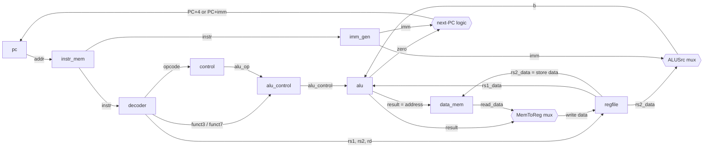
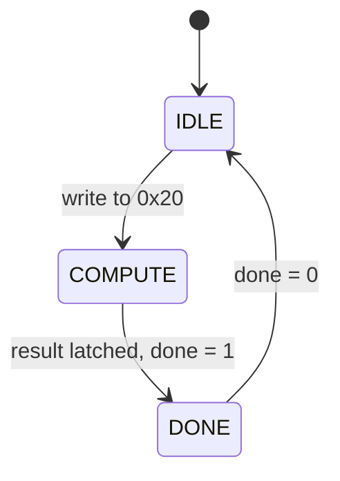
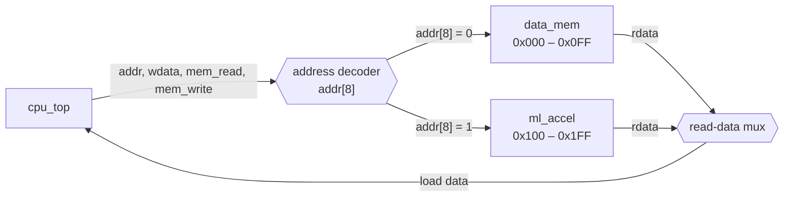
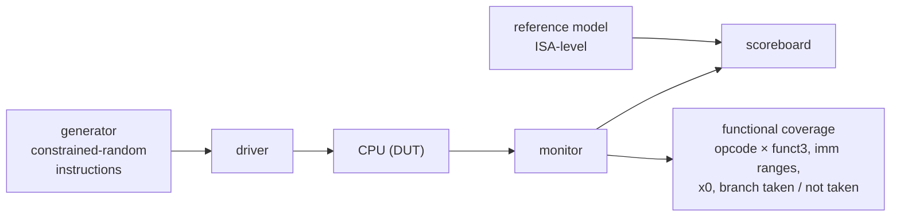

# RISC-V CPU + ML Accelerator SoC

A single-cycle RISC-V (RV32I subset) CPU and a memory-mapped dot-product ML accelerator, written in Verilog and verified in simulation with Icarus Verilog.

The project is now in **Phase 2**: building a class-based, constrained-random SystemVerilog testbench with functional coverage, then turning the CPU into a 5-stage pipeline.

---

## 📍 Status

| Area | Status |
|---|---|
| Single-cycle CPU (`cpu_top`) | ✅ Implemented. Full-program test passes |
| ML accelerator (`ml_accel`) | ✅ Implemented and unit-tested |
| SoC integration (`soc_top`) | ⏳ Designed (memory map below), not yet implemented |
| Class-based SV testbench + coverage | ⏳ Next |
| 5-stage pipeline (hazards + forwarding) | 🗓️ Planned |
| Synthesis / physical design (Yosys, OpenLane, Sky130) | 🗓️ Planned. No results committed yet |

---

## 🧭 CPU Architecture

Single-cycle datapath: every instruction is fetched, decoded, executed and written back in one clock. Only the PC, the register-file write port and data-memory writes are clocked; everything else is combinational.



### Two-level decode

`control` looks only at the **opcode** and produces a 2-bit `alu_op`; `alu_control` turns that plus `funct3`/`funct7` into the exact ALU operation.

| `alu_op` | Meaning | Used by |
|---|---|---|
| `00` | Always ADD (compute address `rs1 + imm`) | `lw`, `sw` |
| `01` | Always SUB (zero flag = equal) | `beq` |
| `10` | Decode `funct3` / `funct7` | R-type, I-type ALU |

### Supported instructions

| Class | Instructions | Notes |
|---|---|---|
| R-type | `add sub sll slt sltu xor srl sra or and` | All 10 |
| I-type ALU | `addi slti sltiu xori ori andi slli srli srai` | See known issue #1 |
| Load / Store | `lw`, `sw` | Word only |
| Branch | `beq` | See known issue #2 |
| Not yet | `lui auipc jal jalr`, byte/half loads & stores | Decode as NOP. `imm_gen` already builds U/J immediates |

---

## 🧠 ML Accelerator (`ml_accel.v`)

Computes the dot product of two 4-element vectors: `A[0]·B[0] + A[1]·B[1] + A[2]·B[2] + A[3]·B[3]`.

| Offset | Register |
|---|---|
| `0x00 – 0x0C` | Vector A[0..3] |
| `0x10 – 0x1C` | Vector B[0..3] |
| `0x20` | Control: any write starts the computation |
| `0x24` | Result (read) |



---

## 🧩 SoC Integration (planned)

Today `data_mem` lives inside `cpu_top` and `ml_accel` is standalone. The plan for `soc_top` is to bring the memory bus out of the CPU and add an **address decoder**:



| Address range | Device |
|---|---|
| `0x000 – 0x0FF` | Data memory (64 × 32-bit words) |
| `0x100 – 0x1FF` | ML accelerator (offsets above) |

Only the selected device receives the read/write enable. Without the decoder, `data_mem` keeps only `addr[7:2]`, so `0x120` would alias onto the same word as `0x020`.

---

## 🧪 Verification

### Current (directed tests, Icarus Verilog)

| Testbench | Style | What it covers |
|---|---|---|
| `alu_tb.sv` | Self-checking | All 10 ALU ops, one vector each |
| `alu_control_tb.sv` | Self-checking | Every `alu_op` / `funct3` / `funct7` combination used |
| `control_tb.sv` | Self-checking | Control signals for each opcode class + unknown opcode |
| `cpu_top_tb.sv` | Self-checking | 10-instruction program (ALU ops, `slt/sltu`, `sw/lw`, taken `beq`). Checks final register values |
| `pc_tb`, `regfile_tb`, `instr_mem_tb`, `decoder_tb`, `imm_gen_tb`, `data_mem_tb`, `ml_accel_tb` | Print-only | Results checked by inspection / waveforms |

### Planned: class-based constrained-random testbench



Goals: per-instruction checking against a reference model (not just end-of-test register state), and **coverage-driven closure**.

### 🐞 Known issues (found during verification review)

1. **`addi` with immediate 1024–1055 executes as SUB.** I-type instructions reuse `alu_control`'s `funct7` check, but for I-type those bits are part of the immediate. A directed test with small constants never hit it, which is exactly the kind of hole functional coverage is meant to expose.
2. **All branches behave as `beq`.** The next-PC logic ignores `funct3`, so `bne`/`blt`/`bge`/`bltu`/`bgeu` are not implemented correctly.

Both will get a failing test in the new testbench **before** the RTL fix.

---

## ▶️ Running Simulations

Requires [Icarus Verilog](https://steveicarus.github.io/iverilog/) (and optionally GTKWave). Run from the repository root.

**Full CPU test:**

```bash
iverilog -g2012 -o cpu_test testbench/cpu_top_tb.sv rtl/cpu_top.v rtl/pc.v rtl/instr_mem.v rtl/decoder.v rtl/control.v rtl/alu_control.v rtl/alu.v rtl/imm_gen.v rtl/regfile.v rtl/data_mem.v
vvp cpu_test | tail -12
```

Expected: `FINAL PROGRAM PASS`.

**Single module** (example: ALU). Swap in any `testbench/<module>_tb.*` and `rtl/<module>.v`:

```bash
iverilog -g2012 -o alu_test testbench/alu_tb.sv rtl/alu.v
vvp alu_test
```

Testbenches dump a `.vcd` for GTKWave (`gtkwave alu.vcd`). Simulation outputs are gitignored.

---

## 📁 Repository Structure

```
rtl/          Verilog RTL (CPU modules, ml_accel; soc_top.v is a placeholder)
testbench/    One testbench per module + cpu_top_tb.sv
doc/          Diagrams (cpu_top_block_diagram.png is the original Graphviz datapath)
synthesis/    Yosys flow (planned)
openlane/     OpenLane / Sky130 flow (planned)
scripts/      Utilities (planned)
results/      Waveforms and reports (planned)
```

---

## 🗺️ Roadmap

1. ✅ Single-cycle CPU + accelerator RTL with directed tests
2. ⏳ Class-based SystemVerilog testbench: transaction, generator, driver, monitor, scoreboard + reference model, functional coverage
3. Fix known issues test-first; extend ISA (`bne`/`blt`…, `lui`, `jal`/`jalr`)
4. `soc_top`: CPU ↔ accelerator over the memory map
5. 5-stage pipeline with hazard detection and forwarding (regression-tested with the new testbench)
6. Stretch: branch prediction or a small cache; Yosys / OpenLane flow on Sky130

## 🔧 Tools

Verilog / SystemVerilog · Icarus Verilog · GTKWave · Vivado (early unit tests) · planned: a class-capable SV simulator, Yosys, OpenLane (Sky130)
